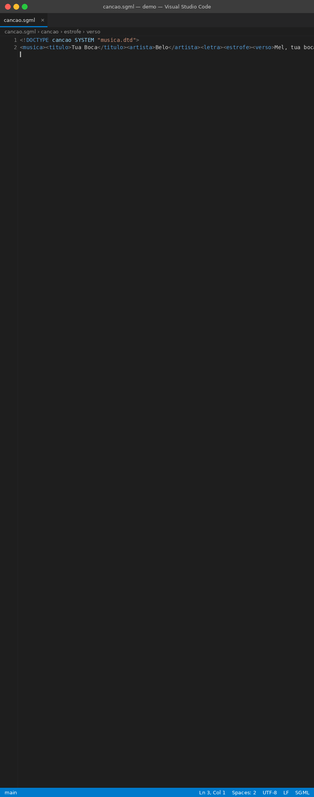

# Bello SGML Pretty Printer

SGML support for VS Code: syntax highlighting, the element hierarchy in breadcrumbs, Outline and Sticky
Scroll, and a pretty-printer that turns hard-to-read SGML into a clean, indented document, even for
technical manuals of tens of megabytes.

`.sgml` and `.sgm` files open as **SGML** with no configuration, and this extension is their default
formatter.

## Features

### Pretty-printing

`Shift+Alt+F` indents the document, one tag or text block per line, sorts attributes and wraps long text.
Large files are pretty-printed to a `*.bello.sgml` copy in the background, without freezing VS Code.

### Element hierarchy

<!--  -->

See where the cursor is in breadcrumbs, Outline, Sticky Scroll and the status bar, and copy the element path.
Omitted end tags are handled without a DTD.

<!--  -->
<!--  -->

### Syntax highlighting

<!--  -->

Tags, attributes, comments, declarations and entities get the same colours as XML in any theme, plus SGML
constructs XML does not have: unquoted and minimized attributes, marked sections and omitted end tags.

## Pretty-printing in detail

- **Format Document** (`Shift+Alt+F`) pretty-prints the open document in place. Documents larger than
  `bellosgml.largeFileSizeMB` are not changed in the editor, because a huge edit can freeze VS Code for
  minutes; you are offered a copy instead.
- **Pretty-print File on Disk to \*.bello.sgml** (right-click the file in the Explorer or the editor) writes
  the result next to the original as `name.bello.sgml`, never changing the original. If that name is taken,
  the copy becomes `name.bello.1.sgml`, `name.bello.2.sgml`, and so on. It runs in the background with
  progress, an estimate of the time left and a Cancel button. A 40 MB document takes a few seconds. Copies
  up to `bellosgml.largeFileSizeMB` open as soon as they are ready; for larger ones click **Open** in the
  final notification. If the file has unsaved changes you are asked whether to save it first.
- **Indentation**: each element's content is indented one level. Elements without an end tag (such as
  `COLSPEC`) stay at the same level as their siblings.
- **Sorted attributes**: start tag attributes are sorted by name. Quoted values, including values with
  spaces, are kept as they are.
- **Text wrapping**: long text is wrapped at the last space before column 80. Words are never cut.
- **Clean whitespace**: blank lines are removed, and text split across several lines is joined.
- **Encoding preserved** in copies: UTF-8 (with or without BOM) and Latin-1 files are written back in the
  same encoding.

## Element hierarchy in detail

With the cursor anywhere in the document you can see which elements it is in, without scrolling:

- **Breadcrumbs** at the top of the editor: `dmodule > content > para`.
- **Outline** view, with each element's `id` (or its first attribute) next to its name.
- **Sticky Scroll**: the enclosing elements stay at the top of the editor while you scroll.
- **Folding** of elements, comments and marked sections.
- **Status bar**: the path of the element under the cursor. Click it to copy `/dmodule/content/para`.
- **SGML: Copy Element Path** (Command Palette): copy the simple path or an XPath with positions, such as
  `/dmodule/content/para[3]`.

### Omitted end tags

Omitted end tags are handled without a DTD:

- `</list>` closes every element still open inside `list`, such as a last `<item>` without `</item>`.
- An element whose name never has an end tag in the document is empty: `<COLSPEC COLNAME="C1">`, and
  milestones such as `<REVST>revised text<REVEND>`. The pretty-printer makes the same assumption.
- `<!ELEMENT graphic - O EMPTY>` in the internal subset is respected.
- List other empty elements in `sgml.emptyElements`.

A name that is closed in some places and not in others (`
one
two
`) nests, because only a DTD can
tell where the first `p` ends.

## Syntax highlighting in detail

Colours match XML in every theme. SGML constructs that XML does not have are highlighted too:

- names with `-`, `.`, `_` and digits, in any case;
- unquoted attribute values (`<para id=p001>`) and minimized attributes (`<list numbered>`);
- processing instructions ending in `>` (`<?Pub Caret>`);
- `<!DOCTYPE ...>` with an internal subset (`<!ENTITY>`, `<!ELEMENT>`, `<!ATTLIST>`) and `-- comments --`
  inside declarations;
- entity references with or without `;` (`&mdash;`, `&mdash`, `&#123;`, `&#x1F;`) and parameter entities
  (`%name;`);
- marked sections: `CDATA`, `RCDATA`, `IGNORE`, `INCLUDE` and `%param;`;
- empty tags `<>` and `</>`. Omitted end tags never break the highlighting.

## Large documents

| Size | What works |
|---|---|
| up to `bellosgml.largeFileSizeMB` (5 MB) | everything, including Format Document in place |
| up to `sgml.hierarchy.maxFileSizeMB` (50 MB) | everything except Format Document, which offers a copy |
| larger than 50 MB | highlighting and pretty-printed copies from the right-click menu only |

The 50 MB limit is VS Code's: it does not give extensions documents larger than that, so in those files the
element hierarchy is never available and no notice can be shown. `sgml.hierarchy.maxFileSizeMB` can be
lowered (larger documents then get a one-time notice) but not raised above 50. Pretty-printed copies are
often much larger than their originals: a 42 MB manual becomes a 68 MB copy.

On a real 42 MB aircraft operating manual (1.3 million lines, 870,000 elements), breadcrumbs and Outline are
ready about 1.2 seconds after the document opens, and later requests reuse the parse until the document
changes. Breadcrumbs, Outline and Sticky Scroll show at most `sgml.hierarchy.maxSymbols` elements (100,000).
When a document has more, they show the top levels (for example `AOM > SECTION > SUBSEC > BLOCK`) and the
status bar still shows the full path. Showing every element of such a document takes about 7 seconds after
every change.

VS Code also turns off highlighting and folding for documents over 20 MB or 300,000 lines
(`editor.largeFileOptimizations`). Large manuals and their pretty-printed copies often pass 300,000 lines.

## Settings

| Setting | Default | Description |
|---|---|---|
| `bellosgml.indent` | `0` | `0` indents with one tab per level; `1` to `8` uses that many spaces. |
| `bellosgml.wrapWidth` | `80` | Column where long text is wrapped (indentation not counted). `0` disables wrapping. |
| `bellosgml.lineEnding` | `crlf` | Line ending of copies: `crlf`, `lf`, or `keep` (same as the original). Format Document keeps the document's line ending. |
| `bellosgml.insertFinalNewline` | `false` | End the output with a line break. |
| `bellosgml.largeFileSizeMB` | `5` | Largest document Format Document changes in the editor, and largest copy that opens automatically. |
| `bellosgml.openLargeFileOutput` | `false` | Also open copies of files larger than `bellosgml.largeFileSizeMB`. |
| `sgml.emptyElements` | `[]` | Elements that never have content or an end tag, such as `colspec`. Case-insensitive. |
| `sgml.hierarchy.inferEmptyElements` | `true` | Also recognise empty elements from `<!ELEMENT x - O EMPTY>` and from the document (names that never have an end tag). |
| `sgml.hierarchy.maxFileSizeMB` | `50` | Larger documents get no element hierarchy. At most 50, VS Code's limit for documents given to extensions. |
| `sgml.hierarchy.maxSymbols` | `100000` | Most elements shown in breadcrumbs, Outline and Sticky Scroll. |

Open the settings with `Ctrl+,` and search for **SGML**.

## Installation

### From the Marketplace

In VS Code, open the Extensions view (`Ctrl+Shift+X`), search for **Bello SGML** and click **Install**, or
run `ext install ppfjuni.bellosgml` from Quick Open (`Ctrl+P`).

### From VSIX (manual)

1. Download `bellosgml-1.1.0.vsix`
2. In VS Code: `Extensions` → `...` (top right) → `Install from VSIX...`
3. Select the file and reload VS Code
